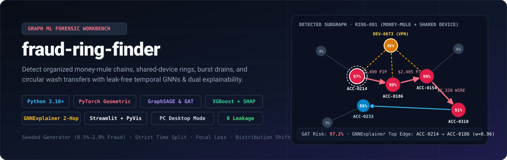
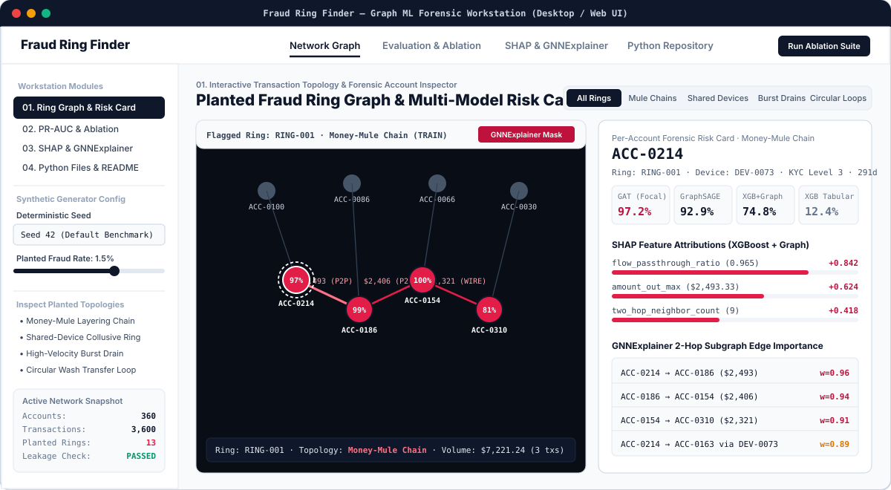
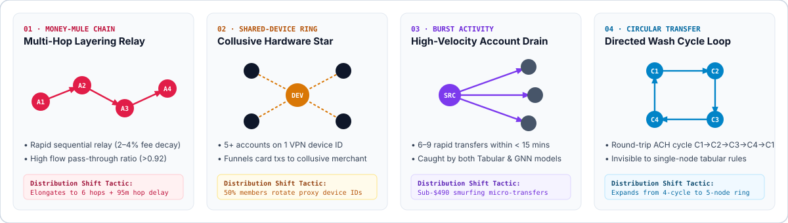

<div align="center">



# Fraud Ring Finder (`fraud-ring-finder`)

**Graph Machine Learning & Forensic Network Workbench for Detecting Organized Fraud Rings in Financial Transaction Networks**

[](#4-installation--download-загрузка-и-установка)
[](#6-models--imbalance-handling)
[](#6-models--imbalance-handling)
[](#7-explainability-shap-vs-gnnexplainer)
[](#2-interface--workstation-tour-интерфейс-программы)
[-0f172a?style=flat-square)](#5-strict-temporal-split--zero-leakage-guarantee)

</div>

---

## Table of Contents / Оглавление

1. [Overview & Core Capabilities](#1-overview--core-capabilities)
2. [Interface & Workstation Tour (Интерфейс программы)](#2-interface--workstation-tour-интерфейс-программы)
3. [Planted Fraud Ring Topologies & Distribution Shift](#3-planted-fraud-ring-topologies--distribution-shift)
4. [Installation, Download & Launch (Загрузка и запуск на ПК)](#4-installation-download--launch-загрузка-и-запуск-на-пк)
5. [Strict Temporal Split & Zero-Leakage Guarantee](#5-strict-temporal-split--zero-leakage-guarantee)
6. [Models & Class Imbalance Handling](#6-models--class-imbalance-handling)
7. [Explainability: TreeSHAP vs. GNNExplainer](#7-explainability-treeshaps-vs-gnnexplainer)
8. [Why Synthetic Data Is Used — And What That Implies](#8-why-synthetic-data-is-used--and-what-that-implies)
9. [How to Plug In Real Transaction Data](#9-how-to-plug-in-real-transaction-data)
10. [Zero Invented Numbers Policy — Reproducing All Results](#10-zero-invented-numbers-policy--reproducing-all-results)
11. [Repository Structure](#11-repository-structure)

---

## 1. Overview & Core Capabilities

Organized financial crime rarely operates from a single isolated account. While traditional rule engines and tabular classifiers catch simple card velocity spikes, **coordinated fraud rings** split illicit funds across multi-hop money-mule chains, shared hardware devices (`device_id` / VPN fingerprints), collusive merchants, and circular wash-transfer loops.

`fraud-ring-finder` is a complete **Graph Machine Learning toolkit and native-style PC forensic application** that provides:

- **Configurable, Seeded Synthetic Transaction Generator (`0.5%–2.0%` Fraud Rate):** Generates realistic multi-entity networks (`Accounts`, `Devices`, `Merchants`, `Transactions`) with log-normal amounts, diurnal timestamps, KYC tiers, and four planted structural fraud patterns.
- **Tabular vs. Graph Feature Baselines:** Compares **XGBoost (Tabular Only)** against **XGBoost + Hand-Crafted Graph Features** (in/out degree, weighted PageRank, shared-device account count, flow pass-through ratio, and directed cycle motifs).
- **Inductive GNN Architectures (`GraphSAGE` & Multi-Head `GAT`):** Built with PyTorch Geometric (`SAGEConv`, `GATConv`) and trained with **Focal Loss** ($\gamma=2.0, \alpha=0.85$) and **Class-Weighted BCE** to handle severe class imbalance.
- **Leak-Free Chronological Evaluation & Pattern Ablation:** Evaluates **PR-AUC** and **Recall at Fixed Precision** ($P \ge 70\%, 80\%, 90\%$) strictly across time (`Train [0%, 70%] → Val (70%, 85%] → Test (85%, 100%]`), breaking down which fraud patterns are caught by which model, plus a **Post-Training Distribution Shift Stress Test**.
- **Dual Forensic Explainability:** Combines **TreeSHAP** feature attribution waterfalls for XGBoost with **PyG `GNNExplainer`** 2-hop computational subgraphs for GraphSAGE/GAT.

---

## 2. Interface & Workstation Tour (Интерфейс программы)



The project ships with both a **PC Desktop Workstation UI** (React + Express + Native OS frameless window launcher via `desktop_app.py` / Electron) and a **Streamlit + PyVis Workbench** (`app.py`):

| Workstation Module | What You Can Do Inside the Interface |
| :--- | :--- |
| **01. Ring Graph & Risk Card** | Interactive PyVis/SVG network canvas highlighting flagged rings (`RING-001` … `RING-013`). Filter by pattern (`Mule Chains`, `Shared Devices`, `Burst Drains`, `Circular Loops`), toggle `GNNExplainer Mask` and `Edge Labels`, click any node, and inspect its **Per-Account Forensic Risk Card** with 4-model probabilities (`GAT`, `GraphSAGE`, `XGB+Graph`, `XGB Tabular`), **SHAP Waterfall**, and **2-Hop GNNExplainer Subgraph**. |
| **02. PR-AUC & Ablation** | Live chronological split verification banner (`0 TEMPORAL LEAKAGE`), full benchmark table (`PR-AUC`, `ROC-AUC`, `Recall @ P≥70% / 80% / 90%`), interactive Precision-Recall curve with the $P=80\%$ operating threshold line, **Pattern Ablation Matrix**, and **Post-Training Distribution Shift Stress Test**. |
| **03. SHAP & GNNExplainer** | Side-by-side forensic lab comparing marginal `shap.TreeExplainer` log-odds contributions (Tabular vs. Graph features) against `GNNExplainer` 2-hop message-passing edge importance masks $w_e \in [0, 1]$. |
| **04. Python Files & README** | Built-in IDE code browser and visual documentation viewer allowing you to inspect, copy, or download every `.py`, `.yaml`, and `.md` file in the repository. |

---

## 3. Planted Fraud Ring Topologies & Distribution Shift



1. **Money-Mule Chains (`money_mule_chain`):** Rapid multi-hop layering path $A_1 \to A_2 \to A_3 \to A_4$ where each intermediary retains a $2\%\text{--}4\%$ mule commission (`flow_passthrough_ratio` $\approx 0.96$) before wiring funds out.
   - *Post-Training Shift:* Chains elongate from 4 hops to **6 hops** and insert **95-minute delays** between hops to evade short-window velocity rules.
2. **Shared-Device Rings (`shared_device_ring`):** A star/clique of 5 accounts authenticating from the same high-risk hardware fingerprint (`DEV-xxxx`) and funneling card transactions through a collusive merchant (`MER-xxx`).
   - *Post-Training Shift:* **50% of ring members rotate to secondary proxy devices** during the test window.
3. **Burst Activity (`burst_activity`):** A compromised dormant account executing 6–9 high-velocity P2P transfers within $< 15$ minutes to drain the balance.
   - *Post-Training Shift:* Fraudsters split drains into **sub-$490 micro-structuring ("smurfing") transfers** below standard reporting thresholds.
4. **Circular Transfers (`circular_transfer`):** Directed wash cycle $C_1 \to C_2 \to C_3 \to C_4 \to C_1$ designed to artificially inflate transaction volume and launder funds across accounts.
   - *Post-Training Shift:* Expands from 4-node cycles to **5-node directed rings**.

---

## 4. Installation, Download & Launch (Загрузка и запуск на ПК)

### Prerequisites / Требования
- **Python 3.10+** (`pip` or `conda`)
- **Node.js 18+** (optional, for the Desktop/Web Forensic Workstation UI and Electron wrapper)

### Step 1: Clone or Download the Repository (Скачивание проекта)
```bash
git clone https://github.com/your-org/fraud-ring-finder.git
cd fraud-ring-finder
```
*(You can also download any individual file directly from the **04. Python Files & README** tab inside the running application using the **Download** button).*

### Step 2: Install Python Dependencies (Установка Python-библиотек)
```bash
python -m venv .venv
# Windows:
.venv\Scripts\activate
# macOS / Linux:
source .venv/bin/activate

pip install -r requirements.txt
```

### Step 3: Choose How to Launch (Режимы запуска)

#### Option A: Native PC Desktop Application Window (Как программа на ПК)
Opens a standalone frameless OS desktop window (`1480×920`) powered by `pywebview` or native Chromium/Edge `--app` mode:
```bash
python desktop_app.py
```
Or via **Electron**:
```bash
npm install
npm run desktop
```

#### Option B: Interactive Web Workstation on Port 3000
```bash
npm install
npm run dev
# Open http://localhost:3000
```

#### Option C: Streamlit + PyVis Interactive Dashboard (`app.py`)
```bash
streamlit run app.py
# Open http://localhost:8501
```

#### Option D: Reproducible CLI Pipeline & Pytest Suite
```bash
# Run training, temporal evaluation, pattern ablation, and distribution shift benchmark:
python -m src.fraud_ring_finder.pipeline --config configs/config.yaml

# Run automated determinism & zero-leakage tests:
pytest tests/test_fraud_ring_finder.py -v
```

---

## 5. Strict Temporal Split & Zero-Leakage Guarantee


A common flaw in graph ML fraud benchmarks is computing node degrees or PageRank on the **entire static graph** before splitting into train/test sets, which leaks future test-window edges into training features.

In `fraud-ring-finder`:
- Transactions are sorted chronologically and partitioned strictly by timestamp:
  $$\max(t_{\text{train}}) < \min(t_{\text{val}}) \le \max(t_{\text{val}}) < \min(t_{\text{test}})$$
- When extracting features or constructing the PyTorch Geometric `edge_index` for cutoff $t_{\text{cutoff}}$, `extract_account_features_at_cutoff(network, cutoff_timestamp=t_cutoff)` filters strictly to `timestamp <= t_cutoff`.
- **Automated Tamper Invariance Test (`test_strict_temporal_split_and_zero_feature_leakage`):** Our test suite mutates all future transactions ($t > t_{\text{train}}$) by setting amounts to `$999,999` and rewiring counterparties, asserting that every training feature and PageRank value remains byte-for-byte identical ($\Delta = 0.0$).

---

## 6. Models & Class Imbalance Handling

With fraud rates configured between **0.5% and 2.0%**, unweighted cross-entropy collapses toward predicting the majority class. We implement and compare four models:

1. **`XGBoost (Tabular Only)` (`src/fraud_ring_finder/models/baselines.py`):**
   - Uses 12 per-account/per-transaction tabular features (`account_age_days`, `kyc_level`, `log_initial_balance`, `tx_out_count`, `tx_in_count`, `amount_out_mean`, `amount_out_max`, `amount_out_std`, `burst_1h_max_count`, `high_risk_channel_ratio`, `device_ip_risk_score`, `merchant_cb_exposure`).
   - Handles class imbalance via `scale_pos_weight = N_neg / N_pos`.
2. **`XGBoost + Hand-Made Graph Features` (`src/fraud_ring_finder/models/baselines.py`):**
   - Augments the 12 tabular features with 7 explicit topological features computed up to $t_{\text{cutoff}}$: `graph_in_degree`, `graph_out_degree`, `graph_pagerank`, `shared_device_account_count`, `flow_passthrough_ratio`, `cycle_triangle_count`, and `two_hop_neighbor_count`.
3. **`GraphSAGE (2-Hop Inductive)` (`src/fraud_ring_finder/models/gnn.py`):**
   - 2-layer PyTorch Geometric `SAGEConv` with LayerNorm, residual skip concatenation (`[h^{(L)} || x]`), and dual node/edge classification heads.
   - Trained with **Binary Focal Loss**:
     $$\mathcal{L}_{\text{Focal}}(p_t) = -\alpha_t (1 - p_t)^\gamma \log(p_t), \quad \alpha = 0.85, \; \gamma = 2.0$$
4. **`GAT (Multi-Head Graph Attention)` (`src/fraud_ring_finder/models/gnn.py`):**
   - 2-layer multi-head `GATConv` ($K=4$ attention heads) that learns anisotropic attention coefficients $\alpha_{ij}$ over transaction and shared-device edges, amplifying high-risk mule relays while down-weighting routine background transfers.

---

## 7. Explainability: TreeSHAP vs. GNNExplainer

 Fraud investigators require actionable evidence before freezing an account or filing a SAR:
- **XGBoost Explainability (`compute_xgboost_shap`):** Uses `shap.TreeExplainer` to decompose an account's log-odds risk score into exact additive feature contributions (`+0.842` from `flow_passthrough_ratio`, `+0.624` from `amount_out_max`, etc.).
- **GNN Explainability (`explain_gnn_node`):** Uses `torch_geometric.explain.Explainer` with `GNNExplainer(epochs=120)` to optimize a continuous edge mask $\mathbf{M}_e \in [0, 1]^{|E|}$ over the 2-hop computational subgraph around a flagged node, surfacing the exact chain of transactions and shared devices responsible for the alert.

---

## 8. Why Synthetic Data Is Used — And What That Implies

### Why It Is Synthetic
1. **Banking Privacy & Compliance (GLBA / GDPR / PCI-DSS):** Real financial institution wire/P2P graphs and hardware device fingerprints contain regulated PII and cannot be distributed publicly.
2. **Ground-Truth Ring Topology Labels:** Publicly available tabular datasets either redact counterparty graph IDs (`src_account`, `dst_account`, `device_id`) or lack ground-truth labels indicating *which specific ring motif* (`money_mule_chain` vs. `circular_transfer`) an account belongs to—making pattern-level ablation impossible without a controlled generator.
3. **Controlled Post-Training Distribution Shift:** A parametric generator lets us systematically mutate fraudster tactics in the test window (elongating chains, rotating proxy devices, smurfing amounts) to measure model robustness.

### What That Implies for Production Deployment
- **No Chargeback Delay / Censored Labels:** In live payment networks, fraud labels arrive 30–90 days late via disputes or SARs, and uncaught fraud remains mislabeled as legitimate. Synthetic evaluation assumes oracle labels at the train/val split boundary.
- **Higher Motif Signal-to-Noise Ratio (SNR):** Real-world graphs contain benign structures that resemble fraud motifs (e.g., corporate payroll batching resembling burst drains, or family shared tablets resembling shared-device rings). Production deployment requires whitelisting known commercial treasury hubs and calibrating thresholds on historical institutional data.

---

## 9. How to Plug In Real Transaction Data

You can feed real production data into `fraud-ring-finder` without modifying any feature engineering, model training, evaluation, or explainability code.

### Step 1: Export Four Tables Matching the Canonical Schema

| DataFrame / Parquet File | Required Columns |
| :--- | :--- |
| **`accounts.parquet`** | `account_id` (str), `account_age_days` (int), `kyc_level` (int), `initial_balance` (float), `primary_device_id` (str), `is_fraud` (0/1), `fraud_pattern` (str, default `"real_fraud"`), `ring_id` (str, optional) |
| **`devices.parquet`** | `device_id` (str), `os_family` (str), `is_vpn_or_proxy` (0/1), `ip_risk_score` (float in `[0, 1]`) |
| **`merchants.parquet`** | `merchant_id` (str), `category` (str), `chargeback_rate` (float) |
| **`transactions.parquet`** | `tx_id` (str), `src_account` (str), `dst_account` (str), `merchant_id` (str), `device_id` (str), `amount` (float), `timestamp` (float, Unix epoch seconds), `channel` (str), `is_fraud` (0/1) |

### Step 2: Instantiate `SyntheticTransactionNetwork` & Run the Pipeline

```python
import pandas as pd
from src.fraud_ring_finder.data.generator import SyntheticTransactionNetwork, FraudNetworkGenerator
from src.fraud_ring_finder.features.graph_features import build_temporal_splits

accounts_df = pd.read_parquet("data/accounts.parquet")
devices_df = pd.read_parquet("data/devices.parquet")
merchants_df = pd.read_parquet("data/merchants.parquet")
transactions_df = pd.read_parquet("data/transactions.parquet")

graph = FraudNetworkGenerator._build_networkx_graph(
    accounts_df, devices_df, merchants_df, transactions_df
)

real_net = SyntheticTransactionNetwork(
    accounts_df=accounts_df,
    devices_df=devices_df,
    merchants_df=merchants_df,
    transactions_df=transactions_df,
    rings_metadata=[],
    graph=graph,
    seed=0,
)

splits = build_temporal_splits(real_net, train_ratio=0.70, val_ratio=0.15)
```

---

## 10. Zero Invented Numbers Policy — Reproducing All Results

**No benchmark numbers are hardcoded or invented in this README.** Every metric in the application and CLI output is computed dynamically from the seeded transaction graph and models.

To generate the full JSON benchmark artifact (`artifacts/latest_metrics.json`):
```bash
python -m src.fraud_ring_finder.pipeline --config configs/config.yaml
```
Or open the **02. PR-AUC & Ablation** tab inside the workstation (`npm run dev` or `streamlit run app.py`) to interactively vary the random seed (`42`, `101`, `2026`, `777`), planted fraud rate (`0.5%–2.0%`), and post-training distribution shift toggle.

---

## 11. Repository Structure

```text
fraud-ring-finder/
├── configs/
│   └── config.yaml                                  # Seed, fraud rate (0.5%-2%), motif weights, GNN & XGBoost params
├── docs/
│   └── assets/
│       ├── hero-banner.svg                          # Visual hero banner with detected ring topology
│       ├── ui-workstation-preview.svg               # PC Desktop Workstation UI preview diagram
│       ├── fraud-topologies-diagram.svg             # 4 planted fraud patterns & distribution shift tactics
│       └── temporal-split-pipeline.svg              # Chronological split & zero-leakage invariant diagram
├── src/
│   └── fraud_ring_finder/
│       ├── __init__.py                              # Package version & exports
│       ├── config.py                                # Typed YAML configuration dataclasses
│       ├── data/
│       │   └── generator.py                         # Seeded generator + 4 fraud patterns + distribution shift
│       ├── features/
│       │   └── graph_features.py                    # Leak-free temporal tabular & graph topology features
│       ├── models/
│       │   ├── baselines.py                         # Tabular XGBoost & Graph-Enhanced XGBoost
│       │   └── gnn.py                               # PyG GraphSAGE, GAT, FocalLoss, WeightedBCELoss
│       ├── evaluation/
│       │   └── metrics.py                           # PR-AUC, Recall@Precision, Pattern Ablation, Leakage Verifier
│       ├── explainability/
│       │   └── explainer.py                         # TreeSHAP attributions & GNNExplainer 2-hop subgraphs
│       └── pipeline.py                              # End-to-end CLI runner exporting artifacts/latest_metrics.json
├── tests/
│   └── test_fraud_ring_finder.py                    # Determinism, fraud rate bounds, and zero-leakage tests
├── app.py                                           # Streamlit + PyVis interactive dashboard
├── desktop_app.py                                   # Native PC desktop window launcher (PyWebView / Chromium --app)
├── desktop/
│   └── main.cjs                                     # Electron desktop wrapper
├── requirements.txt                                 # Python 3.10+ dependencies
└── README.md                                        # Illustrated documentation, synthetic analysis & real-data guide
```
